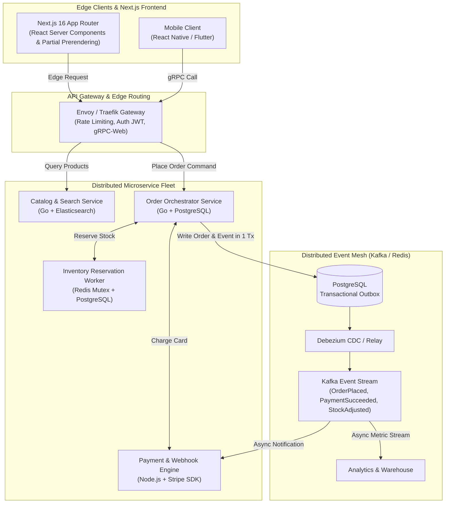

# OmniStore — Distributed Event-Driven Commerce Platform

> **OmniStore** is a high-availability, event-driven distributed e-commerce platform built to handle spiky checkout traffic, atomic inventory reservations, and idempotent payment processing across geographically distributed edge nodes.

---

## 🏛 System Architecture

The architecture separates read-heavy catalog exploration from write-critical checkout operations using CQRS (Command Query Responsibility Segregation) and the Transactional Outbox pattern.

---

## 🚀 Key Engineering Pillars

1. **Transactional Outbox Pattern**: Eliminates dual-write inconsistencies between database mutations and message queues by recording events atomically in the same database transaction.
2. **Atomic Inventory Reservation**: Leverages Redis distributed locks with Lua scripting to prevent race conditions during high-volume flash sales.
3. **Idempotent Webhook Processing**: Stores cryptographic Stripe webhook signatures with deduplication keys, ensuring payments are neither double-charged nor dropped.
4. **Edge-Accelerated Catalog Browsing**: Renders product landing pages with Next.js 16 Partial Prerendering (PPR) and edge cache tags, achieving sub-40ms Time to First Byte (TTFB).

---

## 🛠 Technology Stack

| Domain | Technology | Implementation Role |
| :--- | :--- | :--- |
| **Frontend Storefront** | Next.js 16, TypeScript, Tailwind | Server Components, Partial Prerendering, Edge CDN |
| **Inter-Service RPC** | gRPC, Protocol Buffers v3 | Strongly-typed, binary microservice communication |
| **Backend Services** | Go (Golang), Node.js | Low-latency order processing and payment gateways |
| **Event Streaming** | Apache Kafka, Redis Streams | Decoupled asynchronous event distribution |
| **Databases** | PostgreSQL 16, Redis Cluster | Relational ACID order logs & distributed locks |
| **Payments** | Stripe API | Idempotent payment intent lifecycle management |

---

## 🗺 Engineering Roadmap

- [x] **Phase 1: Architecture RFC & System Specification** (Complete)
- [ ] **Phase 2: Protobuf Schema Definitions & gRPC Microservice Contracts**
- [ ] **Phase 3: Transactional Outbox Engine & Stripe Webhook Consumer**
- [ ] **Phase 4: Next.js 16 Storefront & Edge Caching Integration**

---

## 📄 License
This project is open-source and licensed under the [MIT License](LICENSE).
